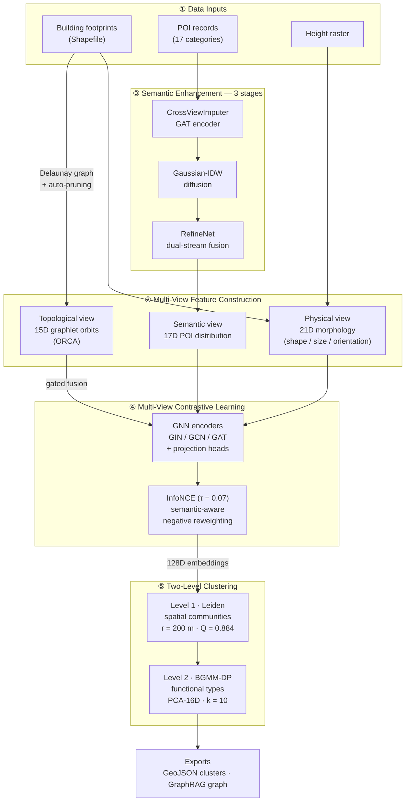

# UFZ-MVGNN

**Multi-View Graph Neural Network for Urban Functional Zone Recognition**

A modular deep learning framework that identifies urban functional zones (e.g., residential, commercial, industrial) from building morphology data using multi-view contrastive learning on graphs.

> **Status**: Core framework complete. Two-level clustering ablation (136 configurations) and MVCL backbone ablation finished on a 323,587-building dataset — see [Results](#results). Code release planned upon paper publication.

---

## Motivation

Urban functional zone (UFZ) recognition is essential for urban planning, resource allocation, and smart city development. Traditional approaches rely heavily on POI (Point of Interest) data, which suffers from **spatial sparsity** — many buildings lack nearby POI annotations.

UFZ-MVGNN addresses this by:
1. **Imputing** semantic information from physical building features via cross-view learning
2. **Diffusing** sparse POI signals across the spatial graph using IDW interpolation
3. **Contrasting** physical, semantic and topological views to learn robust, transferable representations
4. **Clustering** hierarchically: spatial communities first, functional types second

## Architecture



## Key Contributions

### 1. Three-Stage Semantic Enhancement

Addresses POI sparsity through a cascaded pipeline:

| Stage | Module | Description |
|-------|--------|-------------|
| **Imputation** | `CrossViewImputer` | GAT-based encoder predicts POI distribution (17-class) from physical features |
| **Diffusion** | `GaussianIDW` | Inverse distance weighting with Gaussian kernel smooths predictions across spatial neighbors |
| **Refinement** | `RefineNet` | Dual-stream gated fusion network refines POI predictions using both physical and diffused semantic features |

### 2. Multi-View Contrastive Learning (MVCL)

Learns unified building representations by contrasting three complementary views — **physical** (morphology), **semantic** (imputed POI distribution) and **topological** (graphlet orbits of the Delaunay graph, gated into the encoder):

```
Physical (21D)        Semantic (17D)        Topological (15D)
      │                      │                     │
 GNN Encoder            GNN Encoder         gated fusion
      │                      │                     │
 Projection Head       Projection Head             │
      └──────────── InfoNCE Loss (τ=0.07) ─────────┘
              semantic-aware negative reweighting
                          │
                  128D building embedding
```

**Semantic-aware negative weighting**: Negative pairs with similar POI distributions receive lower weights, preventing the model from pushing semantically similar buildings apart.

### 3. Two-Level Clustering

Direct density clustering of building embeddings collapses into a few giant clusters. UFZ-MVGNN instead clusters **hierarchically**:

- **Level 1 — spatial communities**: Leiden community detection on a radius graph (with k-repair and Gaussian smoothing) produces spatially coherent, semantically homogeneous communities.
- **Level 2 — functional types**: Community prototypes (embedding mean/std + semantic mean + log size → PCA) are typed by a Bayesian Gaussian Mixture with Dirichlet Process.

### 4. Extensible Registry Pattern

New features and GNN backbones can be added with zero framework modification:

```python
# Add a custom feature — just register and configure
@FeatureRegistry.register('my_feature')
def compute_my_feature(gdf):
    gdf['custom'] = gdf.geometry.area / gdf.geometry.convex_hull.area
    return gdf

# Add a custom GNN backbone
@BackboneRegistry.register('sage')
class SAGEEncoder(BaseEncoder):
    ...
```

## Results

Experiments on **323,587 buildings** (deduplicated). Full reports: [`docs/results/`](docs/results/).

### Two-Level Clustering Ablation

**Search space**: 57 configurations for Level 1 (radius × Leiden resolution × repair × smoothing) + 79 for Level 2 (KMeans / BGMM-DP / HDBSCAN / DBSCAN / OPTICS / Agglomerative).

**Level 1 — best spatial partition (Leiden + repair):**

| r_comm | resolution | k_repair | σ | Communities | Modularity | Isolated | Intra-sim |
|--------|-----------|----------|-----|-------------|------------|----------|-----------|
| 200 m | 0.01 | 1 | r/4 | 11,663 | **0.884** | 2.6% | 0.990 |

**Level 2 — top configurations (274D community features → PCA-16D):**

| Method | Types | Largest cluster | Gini | Weighted entropy | Score |
|--------|-------|-----------------|------|------------------|-------|
| **BGMM-DP (PCA-16D, init=10)** | 10 | **17.9%** | **0.292** | 2.514 | **0.665** |
| KMeans (k=6, PCA-16D) | 6 | 51.6% | 0.521 | 2.561 | 0.662 |
| KMeans (k=10, PCA-16D) | 10 | 31.2% | 0.516 | 2.542 | 0.648 |
| HDBSCAN (mcs=20) | 2 | 97.7% | — | — | collapsed |

**Findings**:

- **Auto-k density methods fail on this data** — HDBSCAN / DBSCAN / OPTICS / single-linkage all degenerate into one dominant cluster (up to 97.7%) because community prototypes are highly concentrated in the 274-D space.
- **PCA-16D (87.7% variance) beats the full 274-D space** for both BGMM (0.665 vs 0.647) and KMeans, while being 2–4× faster.
- **The DP prior is inert** — five prior values produce identical results; `init_components` is what actually determines k.
- The recommended production config: Leiden (r=200 m, res=0.01) → BGMM-DP (PCA-16D, init=10); KMeans k=10 is the deterministic fallback.

### MVCL Backbone Ablation (Highlights)

| Observation | Evidence |
|-------------|----------|
| **GIN aligns views better than GCN** | consistently higher positive-pair score across ablations |
| **Depth matters most**: GIN 2 → 3 layers | Pos +0.126, ≈ +45% over baseline — best representation quality |
| Wider GCN best at clustering metrics | `gcn_hdim512`: composite clustering score **0.8628** (HDBSCAN mcs=15, PCA-20: 0.8493) |
| Training loss ≠ cluster quality | high-score configs can collapse into 2 large clusters; evaluation must combine metrics with type counts and spatial distribution |

### Sample Outputs

| Artifact | Description |
|----------|-------------|
| [`docs/results/ablation_final_summary.md`](docs/results/ablation_final_summary.md) | Full two-level clustering ablation report (136 configs) |
| [`docs/results/clusters.geojson`](docs/results/clusters.geojson) | Sample GeoJSON export of recognized functional zones |
| [`docs/results/graphrag.json`](docs/results/graphrag.json) | GraphRAG-ready knowledge graph export (nodes + cluster assignments) |

## Project Structure

```
ufz/
├── features/       # Physical features: shape(13) + size(2) + height(3) + orientation(4) + density(5)
├── graph/          # Delaunay triangulation with quantile-based edge pruning
├── semantic/       # 3-stage enhancement: CrossViewImputer → IDW → RefineNet
├── models/         # MVCL model with pluggable GNN backbones (GIN, GAT, GCN)
├── analysis/       # Two-level clustering: Leiden communities + BGMM-DP typing
├── visualization/  # Interactive Plotly visualizations
├── config/         # YAML-based config with inheritance (_base_) support
├── utils/          # Logging, caching, random seed utilities
└── cli.py          # CLI: train / cluster / export / visualize
```

> **Note**: Data loaders, training configs, export modules, and full pipeline scripts will be released upon paper publication.

## Installation

```bash
# Python 3.10+, CUDA 12.0+ recommended
python -m venv .venv && source .venv/bin/activate
pip install -r requirement.txt
```

**Core dependencies**: PyTorch, PyTorch Geometric, GeoPandas, Shapely, scikit-learn, HDBSCAN, Plotly, UMAP

## Usage

```bash
# Full pipeline
python -m ufz train --stage all --config configs/base.yaml

# Step by step
python -m ufz train --stage semantic --config configs/base.yaml   # Stage 1-3
python -m ufz train --stage mvcl --config configs/base.yaml       # Contrastive learning
python -m ufz cluster --config configs/base.yaml                  # Two-level clustering
python -m ufz export --format map --config configs/base.yaml      # GeoJSON export
python -m ufz visualize --type embedding --config configs/base.yaml

# Override config on the fly
python -m ufz train --stage all --device cpu --epochs 30 --seed 42
```

### Configuration

YAML-based with inheritance support:

```yaml
# configs/base.yaml
data:
  shp_path: /path/to/buildings.shp
  poi_path: /path/to/poi.csv

features:
  groups: [shape, size, orientation]

semantic:
  epochs: 200
  hidden_dim: 128
  heads: 4              # GAT attention heads

model:
  backbone: gin          # gin | gat | gcn
  repr_dim: 128
  temperature: 0.07

analysis:
  level1:
    r_comm: 200
    leiden_resolution: 0.01
  level2:
    algorithm: bgmm_dp
    pca_dim: 16
    init_components: 10
```

```yaml
# configs/debug.yaml — inherit and override
_base_: base.yaml
data:
  max_buildings: 500
semantic:
  epochs: 30
device: cpu
```

## Feature Dimensions

| View | Features | Dim | Source |
|------|----------|-----|--------|
| **Physical** | Shape (area, perimeter, circularity, convexity, fractal dim, eccentricity, ...) | 13D | Building geometry |
| | Size (length, width) | 2D | Minimum bounding rectangle |
| | Height (min, mean, std) | 3D | Raster / attribute |
| | Orientation (mean direction, symmetry, ...) | 4D | Principal axis analysis |
| | Density | 5D | Spatial density metrics |
| **Topological** | Graphlet orbits (ORCA) | 15D | Delaunay graph structure |
| **Semantic** | POI category distribution | 17D | Imputed via 3-stage pipeline |
| **Final repr.** | Contrastive learning output | **128D** | MVCL fusion |

## Testing

```bash
pytest tests/ -v
pytest tests/ --cov=ufz --cov-report=html
```

Covers: config parsing, model forward pass, semantic enhancement modules, clustering algorithms.

## Technical Highlights

- **Modular 9-layer pipeline** — each layer is independently testable and replaceable
- **Registry pattern** for features and GNN backbones — zero-modification extensibility
- **Automatic CRS handling** — detects WGS84 vs UTM and converts as needed
- **Config inheritance** — `_base_` support for environment-specific overrides (debug/server)
- **WeightedKLDivLoss** — upweights rare POI categories to handle long-tail distribution
- **Two-level clustering** — Leiden spatial communities + BGMM-DP typing, validated over 136 configurations
- **4,200+ lines** of modular, typed Python across 57 files

## Roadmap

- [x] Two-level clustering ablation (136 configurations)
- [x] MVCL backbone ablation (GIN / GCN, depth / width)
- [ ] Multi-city generalization experiments
- [ ] Pre-trained model checkpoints
- [ ] Paper submission

## License

This project is part of ongoing academic research. Code is provided for review purposes. Full release planned upon paper publication.

## Contact

Yongkang Sun — [GitHub](https://github.com/skysyk12) · syk940940@gmail.com
